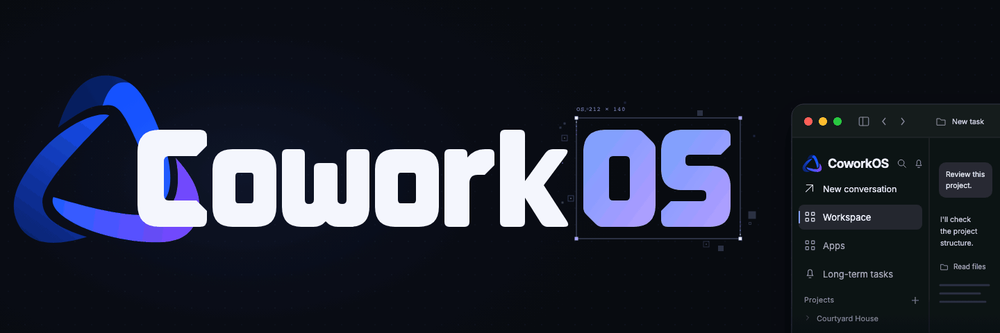
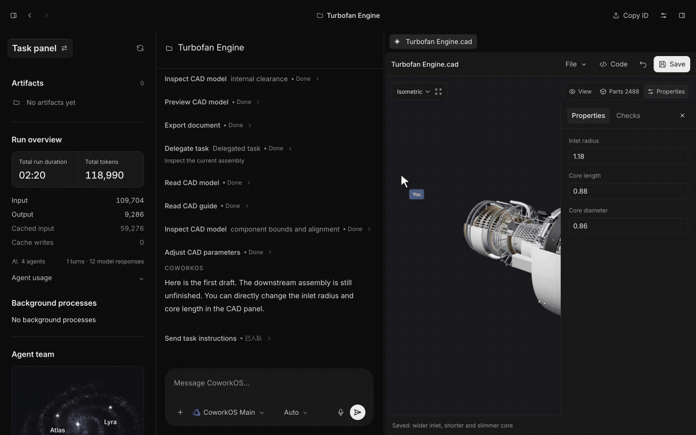

<p align="center">
  <picture>
    <source media="(prefers-reduced-motion: reduce)" srcset="docs/assets/readme-hero.png">
    
  </picture>
</p>

<!-- Add the discussions URL when available. -->
<p align="center">
  <a href="https://arxiv.org/abs/2611.03178"></a>
  <a href="https://coworkos-ai.github.io/"></a>
  <a href="https://coworkos-ai.github.io/showcase.html"></a>
  <br>
  <a href="docs/en/README.md"></a>
  
  <a href="https://www.npmjs.com/package/coworkos-app"></a>
  <a href="LICENSE"></a>
</p>

<p align="center">
  <a href="README.zh-CN.md">简体中文</a> | <b>English</b>
</p>

**CoworkOS is an open-source cowork harness for long-horizon, human-in-the-loop work.** It helps people and AI agents carry complex projects from planning to verified artifacts across code, research, documents, presentations, CAD, Blender and scientific workflows. People and agents can inspect and revise the same evolving work, while configurable model services, workspaces, memory and execution records keep the project on your machine.

- **Complex delivery and continued monitoring.** CoworkOS is designed for difficult productivity tasks that require reasoning, tools and verification, as well as work that unfolds across sessions or days and needs monitoring, decision-making and recovery. Long-running Jobs retain status and logs so work can continue after waiting or interruption.
- **A three-layer runtime for delegated work.** The Main Agent sets the plan, delegates work and evaluates results; the Coordinator Runtime dispatches subtasks and tracks their lifecycles; optional Subagents execute scoped assignments. The model chooses the task strategy while the runtime maintains coordination, feedback and continuity.
- **Shared applications and evolving artifacts.** CLI, search, files and MCP connect with document editors, presentations, CAD and Blender. People and agents can work on the same documents, models and scenes, with hierarchical workspaces, semantic memory and revision-aware candidate changes supporting review before integration.
- **A foundation for agent-driven research.** The same mechanisms support monitoring-heavy loops such as RSI-native model post-training: analyze failures, improve data, run training, validate results and iterate while retaining state and evidence. In the accompanying study, five rounds raised Qwen3.6-35B-A3B's average score from 33.19 to 42.95 across eight benchmarks.

<p align="center">
  
</p>

## Install

**macOS desktop** (Apple Silicon, macOS 14+). Requires [Node.js ≥22.19.0](https://nodejs.org/en/download):

```sh
npx coworkos-app@latest desktop install
```

**CLI only** (macOS / Linux, Node.js ≥22.19.0):

```sh
npm install -g coworkos-app
```

Enter your project directory, configure a model and start the CLI:

```sh
cd /path/to/your/project
coworkos init
coworkos doctor --test-connection
coworkos
```

`coworkos init` prompts for the model service URL, model ID and API key. The connection check sends a model request and uses quota. Describe the work you want done in CoworkOS. After exiting, run `coworkos --continue` in the same directory to continue the latest session. See the [CLI quickstart](docs/en/cli-quickstart.md) for details.

## Documentation and contributing

| Guide                                                            | Description                                                  |
| ---------------------------------------------------------------- | ------------------------------------------------------------ |
| [User guide](docs/en/README.md)                                  | Install CoworkOS, configure models, and explore workflows    |
| [Model settings](docs/en/configuration.md)                       | Configure provider routes, model IDs, and connection formats |
| [Updates and troubleshooting](docs/en/installation-reference.md) | Updates, backup, recovery, and installation troubleshooting  |
| [Development](docs/en/development.md)                            | Build Web/Desktop/CLI and run local checks                   |
| [Contributing](CONTRIBUTING.en.md)                               | Contribution workflow and validation                         |
| [Report an issue](https://github.com/RUC-NLPIR/CoworkOS/issues)  | Report bugs or request changes                               |

## Acknowledgments and license

CoworkOS is licensed under [MIT](LICENSE).


## Citation

If you find CoworkOS useful in your research or product work, please cite:

```bibtex
@misc{jin2026coworkos,
  title         = {CoworkOS: Scaling Agent Coworkers for Real-world Automation},
  author        = {Jiajie Jin and Guanting Dong and Chengjun Pan and Xin Deng and Zhuohui Sheng and Guoqiang Wang and Tao Gui and Yutao Zhu and Yujia Chen and Shihong Yi and Binze Hu and Zhixiong Yang and Zhichao Sun and Rui Wang and Han Han and Mingyu Ma and Junhao Huang and Xiaotao Wang and Huicheng Jiang and Yuyang Hu and Xinyu Yang and Wanghan Xu and Yajie Yang and Zhecan Wang and Honglin Guo and Xiaoyu Xing and Xiaoqian Zhang and Yulun Zhu and Xiaoxi Li and Jiahang Lin and Shaofan Liu and Shihan Dou and Zhiheng Xi and Qi Zhang and Yu-Gang Jiang and See-Kiong Ng and Yang Zhang and Tat-Seng Chua and Ji-Rong Wen and Zhicheng Dou},
  year          = {2026},
  eprint        = {2611.03178},
  archivePrefix = {arXiv},
  primaryClass  = {cs.AI},
  url           = {https://arxiv.org/abs/2611.03178}
}
```

Paper: [arXiv:2611.03178](https://arxiv.org/abs/2611.03178) · Project page: [coworkos-ai.github.io](https://coworkos-ai.github.io/)

## WeChat Group

有任何问题欢迎扫码进群讨论 👏  
安装踩坑、模型配置、工作流复现、issue 反馈都可以在群里直接问。

<p align="center">
  
</p>

> 二维码失效时，请到 [Discussions](https://github.com/RUC-NLPIR/CoworkOS/discussions) 或开 [Issue](https://github.com/RUC-NLPIR/CoworkOS/issues) 联系我们，我们会尽快更新。
