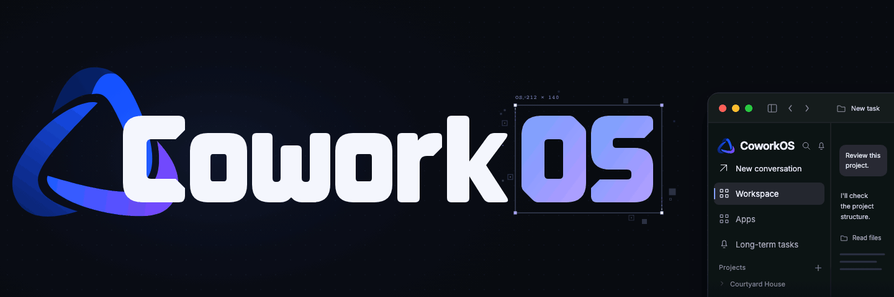
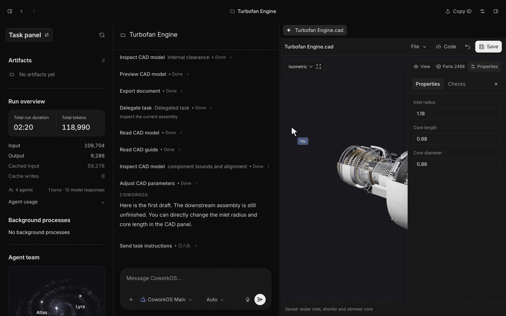

<p align="center">
  <picture>
    <source media="(prefers-reduced-motion: reduce)" srcset="docs/assets/readme-hero.png">
    
  </picture>
</p>

<!-- 待补充讨论区链接。 -->
<p align="center">
  <a href="https://arxiv.org/abs/2611.03178"></a>
  <a href="https://coworkos-ai.github.io/"></a>
  <a href="https://coworkos-ai.github.io/showcase.html"></a>
  <br>
  <a href="docs/README.md"></a>
  
  <a href="https://www.npmjs.com/package/coworkos-app"></a>
  <a href="LICENSE"></a>
</p>

<p align="center">
  <b>简体中文</b> | <a href="README.md">English</a>
</p>

**CoworkOS 是一个面向长程、人机在环工作的开源协作运行时。** 它帮助人与智能体把复杂项目从规划推进到经过验证的产出，覆盖代码、研究、文档、演示文稿、CAD、Blender 和科学计算等工作。人和智能体可以查看并修改同一份持续演化的工作；模型服务可配置，项目工作区、记忆和执行记录保存在本机。

- **复杂交付与持续监控。** CoworkOS 面向需要推理、工具使用和验证的复杂生产任务，也面向跨会话或持续数日、需要监控、决策与恢复的工作。长时间运行的 Job 保留状态和日志，使任务在等待或中断后能够继续。
- **用于委派工作的三层运行时。** Main Agent 负责制定计划、委派工作并评估结果；Coordinator Runtime 负责分发子任务并跟踪生命周期；可选的 Subagents 在限定范围内执行具体任务。模型决定任务策略，运行时负责维持协作、反馈和连续性。
- **共享应用与持续演化的产物。** CLI、搜索、文件和 MCP 可连接文档编辑器、演示文稿、CAD 与 Blender。人和智能体可以共同处理同一份文档、模型或场景；分层工作区、语义记忆和支持修订的候选变更，让人工审阅能够进入整合流程。
- **面向智能体研究的基础设施。** 同一套机制也支持 RSI 式模型后训练等需要持续监控的循环：分析失败、改进数据、运行训练、验证结果，并在保留状态和证据的情况下迭代。配套研究中，五轮实验将 Qwen3.6-35B-A3B 在八个基准上的平均分从 33.19 提升到 42.95。

<p align="center">
  
</p>

## 安装

**macOS 桌面版**（Apple Silicon，macOS 14+）。需要 [Node.js ≥22.19.0](https://nodejs.org/en/download)：

```sh
npx coworkos-app@latest desktop install
```

**仅安装 CLI**（macOS / Linux，Node.js ≥22.19.0）：

```sh
npm install -g coworkos-app
```

进入你的项目目录，配置模型并启动 CLI：

```sh
cd /path/to/your/project
coworkos init
coworkos doctor --test-connection
coworkos
```

`coworkos init` 会引导填写模型服务地址、模型 ID 和 API Key；连接测试会发送模型请求并消耗额度。在 CoworkOS 中描述要完成的工作即可。退出后可在同一目录运行 `coworkos --continue` 继续最近的会话。详见 [CLI 快速开始](docs/cli-quickstart.md)。

## 文档与贡献

| 文档                                                     | 说明                                |
| -------------------------------------------------------- | ----------------------------------- |
| [使用指南](docs/README.md)                               | 安装 CoworkOS、配置模型并了解工作流 |
| [模型设置](docs/configuration.md)                        | 配置服务地址、模型 ID 和连接格式    |
| [更新与排错](docs/installation-reference.md)             | 更新、备份、恢复和安装问题排查      |
| [开发指南](docs/development.md)                          | 构建 Web/Desktop/CLI 并运行本地检查 |
| [贡献指南](CONTRIBUTING.md)                              | 贡献流程和验证要求                  |
| [反馈问题](https://github.com/RUC-NLPIR/CoworkOS/issues) | 报告问题或提出改进建议              |

## 致谢与许可

CoworkOS 采用 [MIT](LICENSE) 许可。
