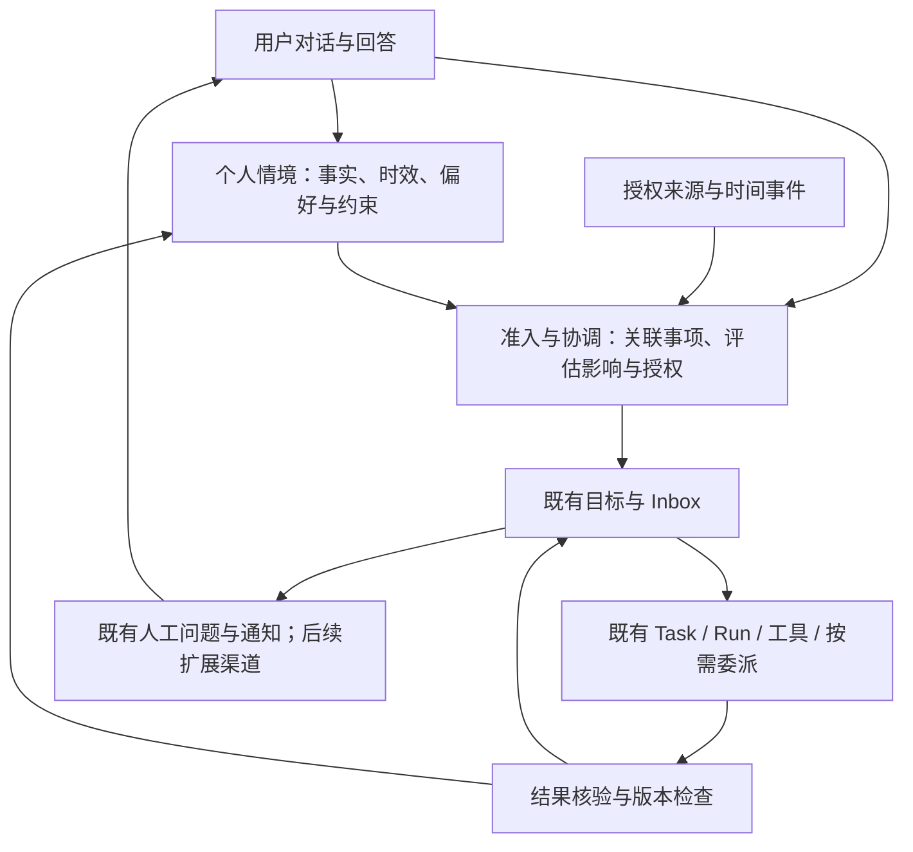

# 私人助理二次开发：方向与迭代路线

更新日期：2026-11-04。首次代码核查基线：`66eed3f`。

本文是本分支私人助理产品定位、整改优先级和里程碑状态的维护入口，专项正文暂为中文。产品定位来自已确认的需求；模块拆分与阶段顺序是据此确定的开发路线，尚未交付的内容均标为计划。现行实现仍以[架构](architecture.md)、[长期目标](long-term-goals-architecture.md)和[用户记忆](user-memory.md)为准；长期原则与决策依据见[开发原则](personal-assistant-principles.md)。

## 1. 产品定位与核心需求

通过对话理解用户的处境和意图，在授权范围内主动发现问题、后台执行工作、核验成果，并在需要时与用户沟通的私人助理。

| 编号 | 已确认的需求                     | 产品验收关注点                                                       |
| ---- | -------------------------------- | -------------------------------------------------------------------- |
| R1   | 自然对话交代事情、补充状态和反馈 | 能更新已有事项；含糊时澄清；不把每句话都新建成目标                   |
| R2   | 跨任务理解当前个人处境           | 状态、偏好、约束有来源和适用范围；临时状态会更新、失效并影响相关事项 |
| R3   | 主动发现问题、提醒或处理         | 从授权来源发现冲突、遗漏、风险和新工作；关联已有事项，避免重复接单   |
| R4   | 在后台持续执行                   | 调用工具、多步推进、必要时换方案；用户不必一直保持页面打开           |
| R5   | 持续改进具体成果                 | 根据标准、证据与反馈反复改进；达到要求后交付，新材料到来后可继续     |
| R6   | 等待后恢复并适度反馈             | 区分等回答、等变化、到期复查与失败重试；保留进展，减少无效唤醒和打扰 |

“后台”以本机服务存活为前提：休眠或服务退出期间不承诺执行。可靠性、预算和授权是上述能力的组成部分。

## 2. 整改方向与范围

复用 CoworkOS 的 Task/Run、工具调用、目标、Inbox、恢复及应用资源；新增个人情境与跨事项协调能力。采用按场景增量改造，先补缺口，再抽稳定接口。

第一阶段围绕三个问题建设：当前哪些事实对用户有效；变化影响哪些事项；哪些行动现在值得且允许执行。应用插件化、目录瘦身、CAD/Blender 扩展和全面界面重写均延后。Windows 原生控制、安装包及多用户/分布式运行独立立项，不作为首个私人助理闭环的前提。

现有功能继续兼容，不通过删除用户任务、重建数据或引入第二套调度绕开问题。外部项目以规则、接口和测试场景为参考，不整体叠加多套运行时。

## 3. 当前基线与真实缺口

状态含义：**已有实现**表示有代码入口；**已验收（限定范围）**表示有对应版本的验收记录；**部分具备**表示仅覆盖部分链路；**待开发**表示目标能力未交付；**暂缓**表示当前不进入主线。代码存在、历史通过和本次重测分别记录。

| 能力                                   | 初始状态           | 依据与缺口                                                                                                                                            |
| -------------------------------------- | ------------------ | ----------------------------------------------------------------------------------------------------------------------------------------------------- |
| 通用执行、委派、持久消息与恢复         | 已有实现           | [架构](architecture.md)、[Run 与进程](../src/runtime/process-host.ts)、[Inbox](../src/runtime/main-inbox-delivery.ts)；不能由此推导私人助理场景已通过 |
| 长期目标、来源采样、复盘与暂停         | 已有实现           | [长期目标](long-term-goals-architecture.md)、[暂停契约](monitoring-pause-contract.md)；沿用既有目标归属与时钟                                         |
| 跨任务稳定用户记忆                     | 已有实现           | [用户记忆](user-memory.md)已有开关、来源、版本和范围；自动学习拒绝临时/不确定候选，不能直接充当临时个人状态库                                         |
| 有时效的个人状态与影响传播             | 待开发             | 缺少覆盖状态更新、失效、跨事项影响分析和执行提交检查的已验收链路                                                                                      |
| 主动发现、关联事项与动作授权           | 部分具备           | 来源与目标机制可以复用；通用个人事务准入、授权依据和跨目标协调需要补齐                                                                                |
| 成果迭代与核验                         | 部分具备           | 已有应用 revision、历史与工具执行；每类外部动作仍需实际结果核验和重复执行保护                                                                         |
| 提问、回答与应用内反馈                 | 已有实现           | [人工交互](../src/runtime/human.ts)、[目标决策](../src/runtime/goal-decisions.ts)；可靠外部通知渠道另行接入                                           |
| Windows Web/运行时与 Electron 源码宿主 | 已验收（限定范围） | 基线含 `8480864`、`ad20e1e` 的开发适配；历史验收涵盖实际模型、停止恢复及部分浏览器/桌面场景，本次仅核查记录和源码，未重跑                             |
| 长期模型连接、常驻与全部 Windows 能力  | 部分具备           | [Windows 指南](windows-development.md)：WorkBuddy 仍为开发中继，全量回归未全绿；原生控制、安装包、崩溃后完整进程回收及长期驻留无完整验收              |

历史本机准备结果允许继续开发，不作为私人助理能力或稳定发行验收。机器绑定日志不进入源码；正式里程碑须提供可共享、脱敏且绑定版本的验收摘要。证据遗失时重新验证，不沿用“已通过”。

## 4. 目标职责与落点

以下是规划职责，模块名称与持久格式在对应阶段落地前评审，不代表已有服务或 API。

| 职责                               | 优先扩展的实现层                            | 边界                                                               |
| ---------------------------------- | ------------------------------------------- | ------------------------------------------------------------------ |
| 情境身份、来源、有效期、状态与版本 | `src/domain/`、`src/runtime/`               | 稳定记忆与临时情境分别建模；存储实现须明确访问范围、迁移和删除语义 |
| 对话提取与相关情境装配             | `.pi/runtime/` 分领域工具、runtime 服务     | 提取只是候选；宿主验证归属、时效和授权；不把全部历史塞进提示词     |
| 主动准入与跨事项协调               | runtime 独立服务、既有 GoalManagement/Inbox | 协调层提交行动或调整意图；现有运行时管理启动、取消和恢复           |
| 来源、动作及核验                   | 连接器、capability provider、领域服务       | 读取、建议、本地修改与对外动作分别授权；凭据留在宿主               |
| HTTP、UI 与宿主装配                | Dashboard 薄路由、前端控制器、desktop       | 界面呈现业务状态；入口不承载核心规则，运行时不反向导入 Dashboard   |

不预先引入通用知识图谱、全套工作流引擎或独立 Worker 平台。先用现有事项和身份建立必要引用；确有跨流程重复需求再抽象。

## 5. 分阶段路线与进度

依赖主线为 M0 → M1 → M2 → M3 → M4 → M5。动作授权、暂停、去重及最小执行预算是每个阶段的门槛；M3 扩展外部来源准入，M5 加固长期运行，不能理解为此前不做权限或成本控制。各阶段以完成标准过关，不用日期或完成百分比代替证据。

| 阶段                      | 目标与范围                                                          | 完成标准                                                                      | 当前状态                                   |
| ------------------------- | ------------------------------------------------------------------- | ----------------------------------------------------------------------------- | ------------------------------------------ |
| M0 开发基线               | Windows Web、本地后台、实际模型、停止恢复、源码桌面宿主             | 独立数据下跑通工具、文件读回、提问回答与重启；逐项列出未支持范围              | 已验收（限定范围）；历史记录，未在本轮重跑 |
| M1 个人情境最小链路       | 对话登记、查询、纠正、结束临时状态；相关任务装配；版本与失效事件    | S1/S2 通过；明确保存范围和处理授权；旧数据可读，关闭或删除不被后台旧结果恢复  | 待开发；下一迭代                           |
| M2 跨事项影响与闭环       | 建立情境到事项的影响引用；生成调整建议；更新并恢复执行              | S3/S4/S5 通过；只触达相关事项，暂停不被绕开；已有运行时唯一执行               | 待开发                                     |
| M3 一个真实来源与主动准入 | 先选一个来源；采集、识别、关联、授权、去重；先读后写                | S6 通过；首次基线静默，失败可见，重放不重复建事项；真实来源专项验收           | 待开发                                     |
| M4 成果改进与可靠反馈     | 一个真实工作成果持续改进；选一个外部反馈渠道；回答关联与送达重试    | S7/S8 通过；实际成果可验证，断网与重启不丢待反馈；重复回答不重复动作          | 待开发                                     |
| M5 日常使用与运行加固     | 独立模型连接生命周期、服务自启/健康、预算、备份与恢复；真实连续使用 | 先完成约定的连续 7 天试用，再按问题扩展多周验收；故障、恢复、用量和漏报均记录 | 待开发                                     |

M5 的连续 7 天是本路线建议的首轮试用门槛，测试数据、运行时段和预算在执行前确定，不是历史已完成记录。M0 遗留问题按场景处理：阻塞当前闭环的 Windows 问题优先修；不把跨平台全量兼容当作所有产品迭代的前置条件。发布前仍执行独立发行门槛。

### 下一迭代：M1 工作清单

- [ ] M1-01 定义临时情境、稳定记忆和事项的边界；确定来源、适用范围、生效/失效、版本、纠正和删除规则。
- [ ] M1-02 明确健康等敏感情境的处理开关与最小保存范围；不自动改变已有记忆开关或学习规则。
- [ ] M1-03 先建立失败用例：假设/引用不落为用户事实；过期状态不再使用；纠正与删除阻断旧提交。
- [ ] M1-04 在领域/运行时实现校验、存储、事件和查询；写清迁移、损坏恢复与回退。
- [ ] M1-05 接入对话工具与请求上下文；新 Task、恢复及压缩后的请求都按当前版本读取相关情境。
- [ ] M1-06 完成 S1/S2 的生命周期测试、本地假模型和实际模型验收；更新当前架构、API、数据布局及状态表。

M1 的首份实现设计应先回答：情境由谁保存；哪些主体可读；如何过期；变化怎样可靠投递到受影响事项；执行前和提交前如何检查。不得仅靠增加全局提示词完成本阶段。

### 后续选择点

首个真实来源可优先评估 OnIt 已有 Outlook 积累；具体账号、数据范围和写权限在接入前确定。首个外部反馈渠道尚未选定，不默认绑定某个平台。开发验收模型沿用已验证的连接路径，长期接入在 M5 补齐，不把开发中继当正式产品能力。

## 6. 场景验收矩阵

以下均为合成场景，不代表用户实际健康、日程或工作数据。默认先使用本地假来源与隔离文件，真实服务另验。测试必须观察持久状态、实际动作和重启结果，不只检查模型措辞。

| 场景              | 输入与预期行为                                                               | 必须覆盖的反例                                                           | 目标阶段 |
| ----------------- | ---------------------------------------------------------------------------- | ------------------------------------------------------------------------ | -------- |
| S1 状态跨任务生效 | 在对话 A 明确报告临时身体不适；授权保存后，对话 B 的新安排读取并考虑有效状态 | “假如我生病了”、替他人写作不登记为用户事实；无关任务不收到完整私密状态   | M1       |
| S2 纠正与失效     | 明确恢复、纠正或到期后，后续执行不再沿用旧限制；时效不明时采用待复核状态     | 不从时间到期推断医学康复；删除/关闭后旧模型结果不重新写回                | M1       |
| S3 影响多个事项   | 三个合成事项中两个受影响、一个无关；只为相关事项提出带依据的调整             | 不取消无关事项；外部日程修改无授权不执行；重要性不由触发频率决定         | M2       |
| S4 暂停与等待     | 执行中用户暂停或改计划；旧回调不能恢复或覆盖；回答投递到原事项               | 不新建替代目标绕过暂停；重复回答和跨会话迟到结果不串归属                 | M2       |
| S5 崩溃与重放     | 更新状态后、投递前模拟中断；重启补投递并重新评估，副作用可核对               | 不丢影响事件、不重复改同一安排；断线且外部结果不明时先核查               | M2       |
| S6 主动发现新工作 | 授权来源出现截止日期/资料缺项，正确关联既有事项或提出新事项                  | 历史基线、重复/乱序事件不重复建任务；来源失败不显示为“没有问题”          | M3       |
| S7 工作持续改进   | 新资料到来后改进已有成果；缺资料提问，回答后继续，达到标准交付               | 手工修改保护；模型自称完成但文件不存在不能成功；明确停止无效循环         | M4       |
| S8 反馈与送达     | 发送失败留待重试，收到可信回答后恢复同一事项，保存外部消息关联               | 重复回调无重复动作；已撤销决策的旧卡片不能授权新动作；不向未授权对象发送 | M4       |

现有回归优先复用：[用户记忆](../test/user-memory.test.js)、[记忆准入](../test/user-memory-admission.test.js)、[长期目标](../test/long-term-goals.test.js)、[暂停](../test/monitoring-pause.test.js)、[Inbox](../test/main-inbox-delivery.test.js)、[重启恢复](../test/main-restart-recovery.test.js)。这些入口不是新增场景已经通过的证明。

## 7. 其他项目及可借鉴模块

外部公开资料核查日期：2026-11-04，链接指向当时的 `main`，不是固定版本或本机实测。以下是结合本产品的迁入建议。复制代码前必须固定提交、核对许可证及依赖、明确本机兼容性；具体实现与验收以本仓库为准。

| 项目与资料                                                                                                             | 借鉴的功能模块                                                           | 本项目落点与时机                  | 采用边界                                                             |
| ---------------------------------------------------------------------------------------------------------------------- | ------------------------------------------------------------------------ | --------------------------------- | -------------------------------------------------------------------- |
| [CoworkOS 架构](https://github.com/RUC-NLPIR/CoworkOS/blob/main/docs/architecture.md)及[当前本地架构](architecture.md) | Main、按需委派、Task/Run、工具与上下文管理                               | 当前主底座，M0 起持续复用         | 保留生命周期和依赖边界，不另起一套运行系统                           |
| [CoworkOS 长期目标](long-term-goals-architecture.md)与[资源协议](software-integration.md)                              | 采样/复盘分离、Inbox、人工问题、revision、成果历史                       | M1–M4 的唤醒、等待和成果协作      | 稳定记忆不等于临时情境；应用 CAS 不等于外部软件事务                  |
| [DeepSeek Super-agent 领域模型](https://github.com/deepseek-ai/dsh-superagent-prototype/blob/main/docs/001-domain.md)  | Source/Trigger/Eval、事项订阅与已有工作关联                              | M2/M3 的主动准入与去重            | 借鉴分层，映射既有目标；不复制 Ticket 成第二套任务注册表             |
| [Super-agent 授权](https://github.com/deepseek-ai/dsh-superagent-prototype/blob/main/docs/002-authorization.md)        | 明确请求、推断工作、Mandate 与权限变更                                   | M2/M3 的行动依据与范围检查        | 来源内容不能授予权限；业务授权与工具/OS 权限分别校验                 |
| [Super-agent 执行](https://github.com/deepseek-ai/dsh-superagent-prototype/blob/main/docs/003-execution.md)            | 输入交付、等待人/事件、执行槽位与恢复                                    | M2/M5 的人工优先与运行加固        | 不照搬其 DSH、GitHub 或平台特定执行环境                              |
| [Agent Autoloop 协议](https://github.com/KKKKhazix/agent-autoloop/blob/main/docs/protocol.md)                          | 事项与执行轮次分离；ask/notice/resolve/later/events 回执；领取与结果重放 | M2/M4/M5 的等待、结果与执行器边界 | 映射到既有 HumanRequest/Inbox/目标复盘；不另启一个自动循环           |
| [Autoloop 插件](https://github.com/KKKKhazix/agent-autoloop/blob/main/docs/plugins.md)                                 | 来源、执行器、通道接口；送达、原消息更新与回答回调                       | M3/M4 的真实来源及可靠反馈        | 先定义最小适配接口；通用应用商店与动态插件加载暂缓                   |
| OnIt 已有实现（历史项目，非本仓库依赖）                                                                                | Outlook 采集游标、分页完成后提交、版本/租约隔离、发布意图与哈希核验      | M3 的连接器及 M2/M4 的一致性规则  | 按模块和测试迁移；不复制凭据、用户数据或旧调度器；哈希不证明语义质量 |

本轮没有决定引入 LangGraph、Temporal 等新运行框架；若出现现有底座无法覆盖的明确需求，再单独记录替代方案、维护成本和迁移条件。侧栏截图中的未具名产品不作为可核查的架构来源。

OnIt 后续迁入时，优先核查其独立仓库中的 `onit/work.py`（发布与核验）、`onit/models.py`（领域合同）及 Outlook 来源实现，并连同对应故障测试迁移。当前仓库只存在开发模型中继的复用路径，不表示上述业务模块已经迁入。

## 8. 持续迭代记录规则

本页只维护定位、阶段、下一步及验收标准；原则与长期决策只更新[原则文档](personal-assistant-principles.md)。现行接口、路径和命令只维护在各自主文档，避免形成第二套手册。

每次迭代使用稳定任务编号，完成后更新阶段表和下一迭代清单。状态可用“待开发、进行中、受阻、待验收、已验收（范围）、暂缓”；受阻必须写明原因与解除条件。没有实际进展时不修改状态制造进度。

每个可验收变更在 PR/发行记录或脱敏验收文档中记录：关联 R/S/M 编号、代码版本、变更模块、数据/接口兼容、实际命令和结果、失败与条件跳过、真实服务范围、遗留问题和回退方法。日志含机器路径、令牌或用户内容时保留本机，维护文档只保存必要的脱敏结论。Git 提交说明使用中文。

| 截止日期   | 进度结论                                                                        | 下一步                                                           |
| ---------- | ------------------------------------------------------------------------------- | ---------------------------------------------------------------- |
| 2026-11-04 | 产品定位已确认；M0 有限定范围的历史验收；本轮建立路线与原则，M1–M5 尚未开始实现 | 从 M1-01 开始，以 S1/S2 建立可复现验收；随后完成 M2 的跨事项链路 |
