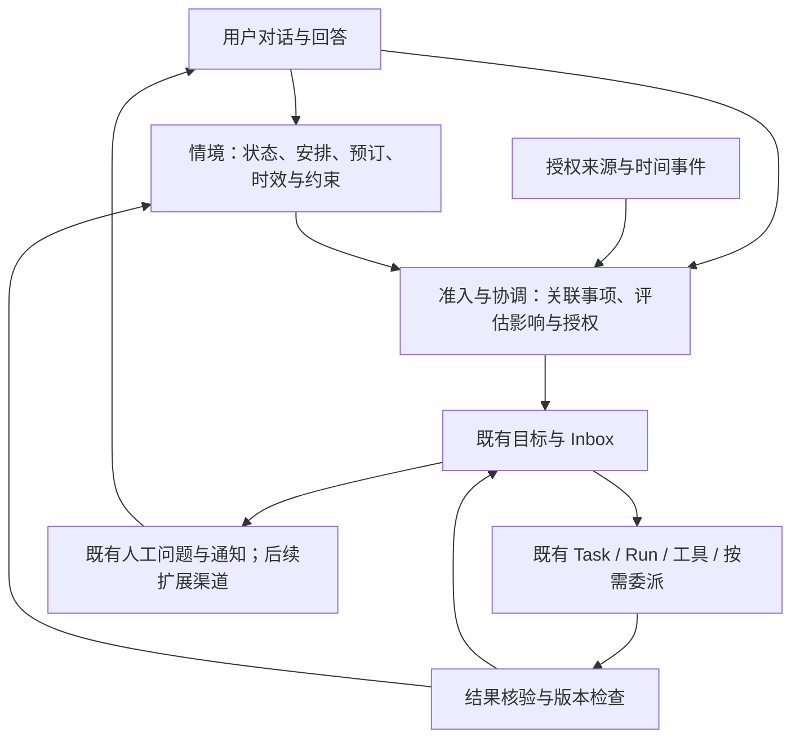

# 私人助理二次开发：方向与迭代路线

更新日期：2026-11-06。首次代码核查基线：`66eed3f`；M1 实现历史基线：`290a785`；本次本地核查基线：`519c4b2`，分支 `feat/windows-blender-wsl`。本次未核查远程同步状态。

本文是本分支私人助理产品定位、整改优先级和里程碑状态的维护入口，专项正文暂为中文。产品定位来自已确认的需求；模块拆分与阶段顺序是据此确定的开发路线，尚未交付的内容均标为计划。现行实现仍以[架构](architecture.md)、[长期目标](long-term-goals-architecture.md)和[用户记忆](user-memory.md)为准；长期原则与决策依据见[开发原则](personal-assistant-principles.md)。

## 1. 产品定位与核心需求

通过对话理解用户的处境和意图，在授权范围内主动发现问题、后台执行工作、核验成果，并在需要时与用户沟通的私人助理。

这里的“情境”包括个人状态、会议等已有安排、旅行计划、已购机票和已订酒店，以及与这些事项有关的外部变化。核心能力是理解“已经安排了什么、还有哪些选择、变化是否值得行动”，既发现冲突与风险，也发现节省费用或改善安排的机会。机票和酒店只是验收场景，不按品类各建一套专用流程。

| 编号 | 已确认的需求                       | 产品验收关注点                                                             |
| ---- | ---------------------------------- | -------------------------------------------------------------------------- |
| R1   | 自然对话交代事情、补充状态和反馈   | 能更新已有事项；含糊时澄清；不把每句话都新建成目标                         |
| R2   | 跨任务理解当前情境与已有安排       | 状态、偏好、会议、行程和已确认预订有来源、时间及适用范围；变更影响相关事项 |
| R3   | 主动发现问题与改善机会、提醒或处理 | 从授权来源发现冲突、遗漏、风险、价格或条件改善；关联已有事项，避免重复接单 |
| R4   | 在后台持续执行                     | 调用工具、多步推进、必要时换方案；用户不必一直保持页面打开                 |
| R5   | 持续改进具体成果                   | 根据标准、证据与反馈反复改进；达到要求后交付，新材料到来后可继续           |
| R6   | 等待后恢复并适度反馈               | 区分等回答、等变化、到期复查与失败重试；保留进展，减少无效唤醒和打扰       |

“后台”以本机服务存活为前提：休眠或服务退出期间不承诺执行。可靠性、预算和授权是上述能力的组成部分。

## 2. 整改方向与范围

复用 CoworkOS 的 Task/Run、工具调用、目标、Inbox、恢复及应用资源；新增个人情境与跨事项协调能力。采用按场景增量改造，先补缺口，再抽稳定接口。

第一阶段围绕三个问题建设：当前哪些事实对用户有效；变化影响哪些事项；哪些行动现在值得且允许执行。应用插件化、目录瘦身、CAD/Blender 扩展和全面界面重写均延后。Windows 原生控制、安装包及多用户/分布式运行独立立项，不作为首个私人助理闭环的前提。

现有功能继续兼容，不通过删除用户任务、重建数据或引入第二套调度绕开问题。外部项目以规则、接口和测试场景为参考，不整体叠加多套运行时。

## 3. 当前基线与真实缺口

状态含义：**已有实现**表示有代码入口；**已验收（限定范围）**表示有对应版本的验收记录；**部分具备**表示仅覆盖部分链路；**待开发**表示目标能力未交付；**暂缓**表示当前不进入主线。代码存在、历史通过和本次重测分别记录。

| 能力                                   | 初始状态           | 依据与缺口                                                                                                                                            |
| -------------------------------------- | ------------------ | ----------------------------------------------------------------------------------------------------------------------------------------------------- |
| 通用执行、委派、持久消息与恢复         | 已有实现           | [架构](architecture.md)、[Run 与进程](../src/runtime/process-host.ts)、[Inbox](../src/runtime/main-inbox-delivery.ts)；不能由此推导私人助理场景已通过 |
| 长期目标、来源采样、复盘与暂停         | 已有实现           | [长期目标](long-term-goals-architecture.md)、[暂停契约](monitoring-pause-contract.md)；沿用既有目标归属与时钟                                         |
| 跨任务稳定用户记忆                     | 已有实现           | [用户记忆](user-memory.md)已有开关、来源、版本和范围；自动学习拒绝临时/不确定候选，不能直接充当临时个人状态库                                         |
| 有时效的情境、已有安排与影响传播       | 待开发             | 缺少覆盖状态及安排更新、失效、跨事项影响分析和执行提交检查的已验收链路                                                                                |
| 主动发现、关联事项与动作授权           | 部分具备           | 来源与目标机制可以复用；通用个人事务准入、授权依据和跨目标协调需要补齐                                                                                |
| 成果迭代与核验                         | 部分具备           | 已有应用 revision、历史与工具执行；每类外部动作仍需实际结果核验和重复执行保护                                                                         |
| 提问、回答与应用内反馈                 | 已有实现           | [人工交互](../src/runtime/human.ts)、[目标决策](../src/runtime/goal-decisions.ts)；可靠外部通知渠道另行接入                                           |
| Windows Web/运行时与 Electron 源码宿主 | 已验收（限定范围） | 基线含 `8480864`、`ad20e1e` 的开发适配；历史验收涵盖实际模型、停止恢复及部分浏览器/桌面场景，本次仅核查记录和源码，未重跑                             |
| 长期模型连接、常驻与全部 Windows 能力  | 部分具备           | [Windows 指南](windows-development.md)：WorkBuddy 仍为开发中继，全量回归未全绿；原生控制、安装包、崩溃后完整进程回收及长期驻留无完整验收              |

历史本机准备结果允许继续开发，不作为私人助理能力或稳定发行验收。机器绑定日志不进入源码；正式里程碑须提供可共享、脱敏且绑定版本的验收摘要。证据遗失时重新验证，不沿用“已通过”。

### 本次核查摘要（2026-11-05）

实现核查基线为 `290a785`，本地变更在此基础上完成测试修复、设计、M1-03/04 内部服务及 M1-05 聊天闭环。既有跨对话稳定记忆和目标交接继续复用；新增情境已接两条 Pi 请求路径及设置管理，可在启动项目后体验保存、跨对话读取、纠正与取消/删除。S1/S2/S9 的完整生命周期、真实模型、事项引用和 Inbox 仍待验收。M0 保留限定范围历史状态；M1 进行中，M2–M5 待开发。

文档已有需求 R1–R6、阶段 M0–M5、场景 S1–S11，以及原则和决策 D1–D7，且中文/英文索引、代码地图与站点导航均有入口。[M1 合同](personal-context-design.md)区分当前聊天能力与后续集成；架构、API、用户入口、数据布局及代码地图已同步。下一步补齐恢复/压缩、容量与事项通知，再单独验收真实模型。

| 文档                                                                                                             | 当前记录情况                                     | 下一次更新条件                                                 |
| ---------------------------------------------------------------------------------------------------------------- | ------------------------------------------------ | -------------------------------------------------------------- |
| 本页：方向与迭代路线                                                                                             | 已记录核心需求、阶段、场景、本次核查和下一步计划 | 每个开发项完成后更新清单和证据；未验收的能力保持待开发或待验收 |
| [原则与决策](personal-assistant-principles.md)                                                                   | 已记录通用规则和 D1–D7；本次核心方向不变         | 实现设计带来新的长期选择或改变已有决定时更新                   |
| [代码地图](code-map.md)、[中文索引](README.md)、[英文索引](en/README.md)                                         | 已有路线与原则入口，专项正文标为中文             | M1 出现真实实现、测试或新设计文档后补入口                      |
| [架构](architecture.md)、[用户记忆](user-memory.md)、[API](product-api.md)、[数据布局](task-workspace-layout.md) | 已登记情境聊天、管理 HTTP、开关与持久边界        | 后续接口变化同步生产者、消费者、兼容与恢复规则                 |
| [M1 合同](personal-context-design.md)与场景验收证据                                                              | 内部服务及限定范围聊天闭环已落地                 | 完成 M1-05b/06；假模型测试不能替代真实语言及完整场景验收       |

在 Windows、Node 24.14.0 下执行：

```sh
npm run test:unit -- --concurrency 1 --file test/user-memory-admission.test.js --file test/long-term-goals.test.js --file test/monitoring-pause.test.js --file test/main-inbox-delivery.test.js
```

首次命令先完成 `build:full`，随后共执行 97 项：96 通过、1 失败、0 跳过。失败在 `test/monitoring-pause.test.js` 的“model guidance and question timeouts cannot resume a paused monitor or create another goal”：`await import(requirePi.resolve("jiti"))` 将 Windows 盘符绝对路径传给 ESM loader，报 `ERR_UNSUPPORTED_ESM_URL_SCHEME`，未到业务断言。

M1-00 已用同一用例再次复现，再将该导入改为 `pathToFileURL(...).href`；保持业务断言不变。修复后执行：

```sh
node --test --test-name-pattern="model guidance and question timeouts" test/monitoring-pause.test.js
node --test test/monitoring-pause.test.js
npm run test:unit -- --skip-build --concurrency 1 --file test/user-memory-admission.test.js --file test/long-term-goals.test.js --file test/monitoring-pause.test.js --file test/main-inbox-delivery.test.js
```

结果依次为 1/1、7/7、97/97 通过，均 0 失败、0 跳过。四文件回归复用上述完整构建，期间未改产品源码。暂停、模型建议、问题超时及替代目标保护均执行到原业务断言；Dashboard 重启与 Inbox 保留的回归包含在本次范围内。本批只修复这一相关测试导入，其他测试中的同类路径未整体整改，全量 Windows 兼容仍不作保证。

前一批设计与测试修复执行 `npm run verify` 全部通过；当时文档检查覆盖 95 文件、3021 个本地链接，源码卫生 0 发现。以下为本批内部服务的独立证据。

### M1-03/04 实现与验收范围

新增[领域校验](../src/domain/personal-context.ts)、[存储](../src/runtime/personal-context-store.ts)、[宿主服务](../src/runtime/personal-context-service.ts)和[回归](../test/personal-context.test.js)。先建立失败测试，确认缺少实现，再落地。当前已通过 18 项内部行为测试：登记与重启、事实/事件一起提交、CAS 竞争、过期/复核、取消、删除与跨 Run 重放、作用域、敏感许可到期、容量失败保留、事件确认、许可实时检查与防伪、双进程并发保存、崩溃临时快照清理。

执行 `node node_modules/typescript/bin/tsc -p tsconfig.json` 和 `node --test test/personal-context.test.js`，17 通过、0 失败、0 跳过。开发中曾因测试把 tentative 安排用于获取执行许可而失败，保留拒绝规则，将测试前置安排明确为 confirmed；未放宽业务断言。来源语义由测试宿主提供确定性判断，尚未证明真实模型识别假设、自述与敏感内容的质量。

追加删除审查先复现崩溃临时文件残留正文，再修复只清理本模块 UUIDv4 临时快照、保留相邻文件。最终执行以下六文件回归，复用当前源码编译结果：

```sh
npm run test:unit -- --skip-build --concurrency 1 --file test/personal-context.test.js --file test/user-memory-admission.test.js --file test/long-term-goals.test.js --file test/monitoring-pause.test.js --file test/main-inbox-delivery.test.js --file test/architecture-boundaries.test.js
```

结果 118 通过、0 失败、0 跳过，包括新增 18 项、既有底座 97 项及架构边界 3 项。`npm run verify` 曾因新文档未格式化停在格式检查，格式化后通过；追加临时快照修复后的最终轻量验证也已通过，包含 CLI 构建、静态与格式检查、文档链接（95 文件、3042 链接、0 错误）和源码卫生（1777 文件、0 发现）。没有执行全量、浏览器、原生或真实模型验收。

前批只新增情境版本 1 文件，不修改稳定记忆、目标或 Task 格式，当时尚未注册工具或路由。本批 M1-05 接入情况见下一节；回退停用新增模块并保留目录，无旧数据迁移，不通过清空屏障恢复运行。

该批未执行全量 Node 回归、浏览器、原生、实际模型、真实来源或长期驻留验收；后续批次的验证分别记录，相关历史通过不继承为本次结果。

### M1-05 聊天闭环与当前限制

已接入共享聊天适配、独立模型语义检查、两条 Pi 请求生命周期、有界当前投影、旧工具查询失效、管理 HTTP 与设置页。浏览器中已执行开启使用、聊天 A 保存、聊天 B 读取、取消、关闭、删除及服务重启；实际持久状态与模型收到的请求均独立核对。测试使用隔离目录和本地假模型，不读取真实账号或任务，不证明真实语言识别质量。设置、范围、使用方法及限制以[情境合同](personal-context-design.md)为准。

新增回归命令：

```sh
node --test --test-concurrency=1 test/personal-context-chat.test.js test/personal-context-api.test.js test/personal-context-pi.test.js
```

浏览器执行 `COWORK_TEST_BROWSER_CHANNEL=msedge` 后运行 `node node_modules/@playwright/test/cli.js test e2e/personal-context.spec.js --workers=1`。首次缺少 Playwright 自带 Chromium 未启动，改用本机 Edge；随后因夹具未悬停显示侧栏新建按钮超时，按现有项目用例补齐真实悬停操作后通过。最新代码最终复验 1/1 通过，覆盖聊天、跨任务、取消、删除、开关及服务重启。开发中一次未等待最新构建而缺导出，另一次预算测试缺少合法 system content；均修复夹具/执行顺序后重新验证，不将失败写成跳过。

`npm run verify:full` 已执行完整构建、lint、两套静态类型、格式、文档/源码检查及发布 runner 自测（9/9），这些步骤通过。全量发现 400 个 Node 文件并运行到至少 692 项时，出现 Windows ESM 路径、命令进程、PPTX 字节长度、MCP 环境路径及文件替换等失败，另有 HTTP 夹具请求失败；涉及本次未修改的应用/CLI/命令测试文件。已停止该全量进程树，不宣称全量通过或已证明这些均为基线缺陷，未取得最终全量统计。

随后执行 12 个相关文件回归，首轮 142 项中 141 通过、1 失败、0 跳过；失败为 `monitoring-pause` 激活竞争测试的 Windows `EPERM` 原子替换占用。单独重跑该文件及最新聊天/Pi 文件，19/19 通过；保留首次失败，不将重跑通过当作稳定性问题已修复。最终 12 文件回归 **144 通过、0 失败、0 跳过**，包括新增情境 31 项（领域/存储 18、聊天 9、API 1、来源/真实 Pi 3）及既有记忆、目标、暂停、Inbox、HTTP 与架构边界。执行命令如下：

```sh
npm run test:unit -- --skip-build --concurrency 1 --file test/personal-context.test.js --file test/personal-context-chat.test.js --file test/personal-context-api.test.js --file test/personal-context-pi.test.js --file test/user-memory.test.js --file test/user-memory-pi.test.js --file test/user-memory-admission.test.js --file test/long-term-goals.test.js --file test/monitoring-pause.test.js --file test/main-inbox-delivery.test.js --file test/architecture-boundaries.test.js --file test/http-boundary.test.js
```

源码已由 `tsc -p tsconfig.json` 编译，最终轻量 `npm run verify` 全部通过：CLI 构建、lint、两套静态类型、格式、文档链接（95 文件、3075 链接、0 错误）及源码卫生（1787 文件、0 发现）。真实模型、真实来源与长期驻留未验收；后续 Windows 桌面限定范围验证如下。

同日按用户要求运行 `npm run desktop:prepare`，通过现有 electron-builder 配置显式选择 Windows x64、`--dir` 与独立本地产物目录生成可运行目录版；未改 macOS 默认打包命令，未签名、未制作安装器。执行 `node node_modules/@playwright/test/cli.js test e2e/windows-desktop.spec.js --workers=1`，连接模型、草稿保存及应用重开 1/1 通过。另用隔离用户目录启动打包后的可执行文件，核对 `app.isPackaged`、包内资源路径、后台连接、本地假模型连接及“情境与安排”三开关与空列表，全部通过；首次夹具在保存连接触发后台重启时提前操作页面，改为等待新端口页面导航后通过。包中未包含根用户配置、任务和工作区目录。以上不等于真实模型、Windows 安装/自动更新、原生控制或完整 M1 场景验收；Windows 打包应用的自动更新当前仍仅支持 macOS 分发链路。

随后恢复此前使用的 WorkBuddy 开发中继和 `glm-5.3-flash`：网页版经模型设置 HTTP 保存启用，目录版经可信主窗口 IPC 测试并加密保存，再核对后台重启后的配置。两端真实连接检查均通过流式响应及工具调用。此前启动遗漏了旧开发环境的模型连接，不能将隔离假模型验证称为用户配置完成；现已补齐。此次只证明真实连接可用，不替代 M1 情境语义质量或完整生命周期验收。中继凭据不进入源码或桌面包，连接依赖本机中继持续运行及 WorkBuddy 登录有效。

### M1-05a：运行中切换开关的错误反馈修复

用户报告登记失败。只核对该会话的工具轨迹及情境版本元数据：保存与查询均为 `conflict`，设置版本在该轮消息期间变化，用户也确认切换过开关。未保存安排是旧授权失效保护；缺陷在 `refreshMessages` 将非 JSON 的失败工具结果误改为旧查询撤销提示，造成错误解释。另发现接收时间仅在相关请求且开启使用时投影，导致普通日期行动表达缺少相对日期依据。

先添加回归，三个缺陷测试失败，独立敏感开关保护测试通过；修复后执行 `node --test --test-concurrency=1 test/personal-context-chat.test.js test/personal-context-pi.test.js test/personal-context.test.js test/personal-context-api.test.js`，**35 通过、0 失败、0 跳过**。两条真实 Pi 路径核对下一轮模型收到的真实错误，不只检查本地异常；仍拒绝旧请求在开关变化后提交。新增第一人称日期行动查询、关闭使用时的日期依据、敏感处理拒绝和失败错误保留检查。`npm run verify` 全部通过（文档 95 文件、3075 链接；源码卫生 1787 文件、0 发现）。

WorkBuddy 在隔离数据中使用合成公开活动检查相对日期与实际落盘；首次未落盘，未留失败工具诊断，原因未定位；加入诊断后同输入复验通过，日期为 2026-11-15、未虚构具体时刻。不能以该单次通过宣称真实模型识别稳定。Windows 目录版已重新打包、核对两个修改模块与源码构建哈希，并同步此前桌面入口；隔离包的启动、后台、假模型连接与情境设置检查通过，但退出未完成，已核实并清理仅本次隔离检查的进程树，退出可靠性不记通过。

浏览器新增运行中切换开关的真实 UI 回归已通过，核对真实冲突与零落盘。首轮两用例中原有跨对话用例在第二轮停止按钮收起处超时；将两轮相同完成文本改为不同标记，避免把旧轮回答视为新轮完成后，再行复验。执行 `COWORK_TEST_BROWSER_CHANNEL=msedge` 后运行 `node node_modules/@playwright/test/cli.js test e2e/personal-context.spec.js --workers=1`，最终 **2/2 通过**，包含跨对话/设置完整流程与新增冲突流程；保留首次失败，不视为桌面退出问题已解决。

### M1-05a：语义校验 JSON 展示格式修复

用户再次反馈最终成功、过程中仍有失败。核对该会话轨迹，第一次保存为 JSON 解析异常，第二次保存成功，实际只有一条记录；没有补写或修改用户安排。根因是独立语义检查返回带 `json` 代码块的 JSON，而实现直接调用 `JSON.parse`。新增[响应格式回归](../test/personal-context-assessment.test.js)先复现同一异常，再兼容纯 JSON 或单个完整 JSON 代码块；只归一化展示包装，保留严格字段校验、独立授权与敏感处理规则。多段、带说明文字、残缺、超长、字段错误或截断统一返回 `assessment_invalid`，不携带原始响应片段、不自动重试。

执行 `node --test --test-concurrency=1 test/personal-context-assessment.test.js test/personal-context-chat.test.js test/personal-context-pi.test.js`，**35 通过、0 失败、0 跳过**，包括响应格式 19 项、聊天边界 13 项、两条 Pi 路径及来源 3 项。真实 Pi 使用带代码块的批准/拒绝和错误 JSON，核对单次校验、真实错误反馈及无效响应零落盘；新增测试不是对模型已保存结果的模拟。`npm run verify` 全部通过（95 文档、3077 链接、1788 源码文件、0 发现）。两份本地桌面目录同步本轮重新编译的聊天适配与领域错误模块，不改用户数据。

本轮 WorkBuddy 合成场景实际保存成功，但“具体时间未定应保持未知”的断言失败：模型填入了日期当天零点。该时间精度问题独立记录，不能把格式兼容通过写成实模语义全通过，也不能据此前单次通过宣称不会补造时刻。下一步优先明确仅日期与未知时刻的表示/校验，再推进 M1-05b 其余内容。浏览器使用 Edge 执行 `node node_modules/@playwright/test/cli.js test e2e/personal-context.spec.js --workers=1`，**2/2 通过**；首个流程仅发起一次保存，校验结果带代码块仍完成保存与跨对话读取，另一个流程继续验证开关冲突零落盘。

### M1-05a：个人事项概览读取修复

重启后的概览查询仍失败。核对该会话的工具开始/结束事件与管理元数据：使用、登记、敏感处理开关均开启，已有用户级待确认安排仍存在，实际查询却返回 `permission_denied`。根因是查询、投影与历史快照刷新共用的准入规则依赖具体安排词，未将“最近我有什么事”等个人事项概览视为相关用途。新增概览、下一步待办、英文问法以及无关/第三方反例，先复现失败，再统一扩展共享准入；未识别的查询改报 `request_not_relevant`，不能据此声称权限撤销或数据缺失。只扩展读取用途，不改变保存授权、敏感开关、范围、版本或状态规则。

对抗检查发现省略主语的时间问句可能误接纳第三方查询；补充人名/第三人称反例后，限定时间短语直接接概览问题，不把“最近他有什么事”解释为本人查询。待确认记录仍返回 `tentative/needs_review`，查询不改写为已确认。当前概览限于已登记情境，不代表外部日历、待办或所有历史聊天都已检索。

首轮执行 `node --test --test-concurrency=1 test/personal-context-assessment.test.js test/personal-context-chat.test.js test/personal-context-pi.test.js test/personal-context.test.js test/personal-context-api.test.js`，75/75 通过；Edge 执行 `node node_modules/@playwright/test/cli.js test e2e/personal-context.spec.js --workers=1`，2/2 通过。浏览器在新对话发送概览问题，实际调用查询，再依据返回事项显示内容；两条 Pi 路径核对投影、工具结果和下一次模型请求均保留记录。对抗收紧后执行 `node --test --test-concurrency=1 test/personal-context-chat.test.js test/personal-context-pi.test.js`，41/41 通过、无失败或跳过。`npm run verify` 全部通过（95 文档、3078 链接、1788 源码文件、0 发现）；桌面目录同步两个已编译模块，未重新验收原生退出或完整安装包。

WorkBuddy `glm-5.3-flash` 在隔离数据上通过一次真实概览检查：预置合成待确认活动，对话 B 只问概览，实际回复包含活动、日期及时间地点未定，并核对记录未改变。这证明本次读取场景可用，不代表登记语义、时间精度、所有自然语言或完整 M1 均验收通过。未重放用户消息、重复登记或修改真实安排；未知时刻被补为零点的遗留问题仍待处理。

### M1-05a：事项类型、来源引用与失败纠错修复

新消息登记再次失败。核对工具开始/结束事件，模型把计划事项当作临时状态，并反复添加该类型不允许的时间字段；笼统的跨字段错误未给出可执行纠正方式，已经出现二十余次重复调用。已通过正常停止入口终止这轮无效重试，未删除聊天或已有安排。这个失败独立于上轮概览查询修复，不能用此前的读取验收证明登记成功。

领域字段描述明确两种类型、合法状态及时间条件；聊天入口将结构错误映射为 `invalid_request`，同一消息只允许一次参数纠正，之后阻止写入。来源/语义拒绝、冲突或提交失败直接阻止后续写入，不能更换类型或范围绕过。登记结果明确 `reminderScheduled=false`，复核时刻不是调度器，未创建并核实独立提醒前不能承诺到时通知。校验每次接收当前候选，不能复用前次候选判断。

原始输入在隔离网页实模复验时还暴露来源空白差异：不换行空格被模型变成普通空格。新增回归先复现，再仅允许空白展示匹配，恢复为可信原文片段后继续语义校验；文字变化仍拒绝。复验随后出现一次独立校验失败，未放宽授权或自动重试；单独使用同一候选探测实际校验通过，尚不能据此认定端到端实模稳定。

初轮新增三项回归均失败，修复后通过；引用空白回归同样先失败后通过。期间与实模浏览器一起执行的 CLI 整体用例两次超过 120 秒，隔离回收仅本次测试进程；中间单独执行同一 CLI 用例通过，不能据此认定并行压力验收通过。浏览器新增用例首次在回复后的停止按钮收起等待超时，仍保留该失败；将等待完整生命周期的上限改为 30 秒后，Edge 三项流程全部通过。

原始输入首次保存成功的实模回复仍把猜测的复核钟点说成提醒时间。新增“模糊晚上不落精确钟点或自动失效”回归先失败，再由宿主省略没有钟点依据的新安排时间字段，并明确返回省略字段；日期/季节留在正文，更新保留既有相同时间。此限定门槛不证明所有时间语义正确，临时状态合同和旧记录不自动迁移。最终原始输入在隔离网页实测通过：实际只调用一次保存，持久记录为待确认安排，无猜测的开始/复核/失效时刻，回复明确不自动通知；本次独立校验约 5.8 秒正常完成。先前独立校验偶发失败仍保留，不能宣称 WorkBuddy 接入或 M1 实模已全面稳定。

当前执行 `node --test --test-concurrency=1 test/personal-context-chat.test.js test/personal-context-assessment.test.js`，64/64 通过、无失败或跳过；此前领域/管理/聊天/响应格式组合 80/80 通过。最终单独执行 `node --test --test-concurrency=1 test/personal-context-pi.test.js`，3/3 通过、无失败或跳过，含真实 CLI 和内部 RunService 路径。最终 Edge 执行 `node node_modules/@playwright/test/cli.js test e2e/personal-context.spec.js --workers=1`，3/3 通过，包含类型纠正、跨对话概览/管理、运行中开关冲突。完整时间语义、恢复授权和原生退出仍不记为通过。

`npm run verify` 全部通过（95 文档、3078 本地链接、1788 源码文件、0 发现）。两个本地桌面目录同步当前构建的聊天适配与领域模块，并核对哈希一致；未重验完整安装包。真实数据保留原记录及版本，未将测试事项写入；用户失败消息仍需通过新一次正常提交登记，不能把隔离实测称为已替用户保存。

M1-05a 的可体验聊天闭环已交付；M1-05b 保留容量维护、人类回答与内部恢复授权、已有事项引用及 Inbox 消费。当前相关性为有限规则，同一消息同类/同范围保存最多一条；不把“继续”等省略表述、并发计划执行、强制压缩恢复或外部动作称已完整支持。不自动创建目标，不自动取消外部会议/预订。M1-06 仍需单独的真实模型和完整 S1/S2/S9 验收。

## 4. 目标职责与落点

以下是规划职责，模块名称与持久格式在对应阶段落地前评审，不代表已有服务或 API。



| 职责                               | 优先扩展的实现层                            | 边界                                                               |
| ---------------------------------- | ------------------------------------------- | ------------------------------------------------------------------ |
| 情境身份、来源、有效期、状态与版本 | `src/domain/`、`src/runtime/`               | 稳定记忆与临时情境分别建模；存储实现须明确访问范围、迁移和删除语义 |
| 对话提取与相关情境装配             | `.pi/runtime/` 分领域工具、runtime 服务     | 提取只是候选；宿主验证归属、时效和授权；不把全部历史塞进提示词     |
| 主动准入与跨事项协调               | runtime 独立服务、既有 GoalManagement/Inbox | 协调层提交行动或调整意图；现有运行时管理启动、取消和恢复           |
| 来源、动作及核验                   | 连接器、capability provider、领域服务       | 读取、建议、本地修改与对外动作分别授权；凭据留在宿主               |
| HTTP、UI 与宿主装配                | Dashboard 薄路由、前端控制器、desktop       | 界面呈现业务状态；入口不承载核心规则，运行时不反向导入 Dashboard   |

不预先引入通用知识图谱、全套工作流引擎或独立 Worker 平台。先用现有事项和身份建立必要引用；确有跨流程重复需求再抽象。

## 5. 分阶段路线与进度

依赖主线为 M0 → M1 → M2 → M3 → M4 → M5。动作授权、暂停、去重及最小执行预算是每个阶段的门槛；M3 扩展外部来源准入，M5 加固长期运行，不能理解为此前不做权限或成本控制。各阶段以完成标准过关，不用日期或完成百分比代替证据。

| 阶段                      | 目标与范围                                                           | 完成标准                                                                        | 当前状态                                                    |
| ------------------------- | -------------------------------------------------------------------- | ------------------------------------------------------------------------------- | ----------------------------------------------------------- |
| M0 开发基线               | Windows Web、本地后台、实际模型、停止恢复、源码桌面宿主              | 独立数据下跑通工具、文件读回、提问回答与重启；逐项列出未支持范围                | 已验收（限定范围）；历史记录，未在本轮重跑                  |
| M1 情境与已有安排最小链路 | 对话登记、查询、纠正、结束状态与安排；关联既有事项；版本与失效事件   | S1/S2/S9 通过；明确保存范围和处理授权；旧数据可读，关闭或删除不被后台旧结果恢复 | 进行中：05b 显式关联/投递已接入；持续授权、容量及 06 待完成 |
| M2 跨事项影响与闭环       | 建立情境到事项的影响引用；检查安排冲突；生成调整建议；更新并恢复执行 | S3/S4/S5/S10 通过；只触达相关事项，暂停不被绕开；已有运行时唯一执行             | 待开发                                                      |
| M3 一个真实来源与主动准入 | 先选一个来源；采集、识别、关联、授权、去重；发现风险或改善机会       | S6/S11 通过；首次基线静默，失败可见，重放不重复建事项；真实来源专项验收         | 待开发                                                      |
| M4 成果改进与可靠反馈     | 一个真实工作成果持续改进；选一个外部反馈渠道；回答关联与送达重试     | S7/S8 通过；实际成果可验证，断网与重启不丢待反馈；重复回答不重复动作            | 待开发                                                      |
| M5 日常使用与运行加固     | 独立模型连接生命周期、服务自启/健康、预算、备份与恢复；真实连续使用  | 先完成约定的连续 7 天试用，再按问题扩展多周验收；故障、恢复、用量和漏报均记录   | 待开发                                                      |

M5 的连续 7 天是本路线建议的首轮试用门槛，测试数据、运行时段和预算在执行前确定，不是历史已完成记录。M0 遗留问题按场景处理：阻塞当前闭环的 Windows 问题优先修；不把跨平台全量兼容当作所有产品迭代的前置条件。发布前仍执行独立发行门槛。

### 下一迭代：M1 工作清单

- [x] M1-00 修复暂停回归的 Windows ESM 模块加载，重跑该文件及第 3 节的四文件回归，结果 7/7 与 97/97 通过；此项只解除验证障碍，不计为情境功能交付。
- [x] M1-01 完成[情境合同](personal-context-design.md)：临时状态、安排与稳定记忆的边界，来源、时间/时区、范围、失效、版本、纠正、删除和恢复规则；领域代码已落地。
- [x] M1-02 明确独立开关与最小保存范围，保留既有记忆语义。内部设置/许可及设置入口已实现。
- [x] M1-03 先建立失败用例，完成 18 项内部回归：宿主判为假设/第三方或未授权时拒绝保存，意向不取得执行许可，改期/取消/删除阻断旧提交，到期不推断康复或履约；崩溃临时快照清理不碰相邻文件。真实语言判断及聊天场景待验收。
- [x] M1-04 实现领域校验、短锁快照、原子变更事件、按 ID/范围/用途查询及来源/版本/许可服务；记录新格式、容量、损坏保留与回退。事件未接 Inbox，尚无影响关系或调度消费者。
- [x] M1-05a 接入对话工具、当前请求投影、独立判断器与设置管理；两条真实 Pi 路径及跨 Task 浏览器闭环通过限定范围验证。
- [ ] M1-05b 部分实现：显式 Task/Run 引用、Inbox 消费与限定范围只读恢复已接入；容量维护、完整持续授权及跨 Run 交接待完成，不清空重放屏障。
- [ ] M1-06 完成 S1/S2/S9 的生命周期测试、本地假模型和实际模型验收；更新当前架构、API、数据布局及状态表。

M1 的首份实现设计应先回答：情境由谁保存；哪些主体可读；如何过期；变化怎样可靠投递到受影响事项；执行前和提交前如何检查。不得仅靠增加全局提示词完成本阶段。

### 下一步开发顺序与交付边界

#### 2026-11-06 核查与执行计划

当前已交付的是情境登记、跨对话读取和管理的限定范围闭环，M1 仍在进行中。核心需求是理解当前处境、让变化影响相关工作，并在授权范围内持续推进和核验；不能由“记住并能回答”推导已经具备主动助理能力。M2–M5 保持待开发，不用文件数、提交数或测试通过率换算产品完成百分比。

开发前的代码核查确认四个主线缺口（本批进展见下方）：

- 变更有同快照事件，但 `pendingChanges/acknowledgeChange` 尚无生产消费者；已有事项未登记情境依赖，更新不会自动通知相关工作。
- `prepareExecution/validateExecution` 已有内部服务与测试，但尚未接入生产执行链；恢复、提交前的宿主检查不能由当前聊天投影代替，也不能承诺拦截所有通用工具副作用。
- 快照限制为 200 条记录、256 条事件、512 条收据、1024 条请求及 2 MiB，超限拒绝写入；尚无完整的消费与维护策略。不能通过清空请求/收据解除容量限制，避免旧消息重新取得写入资格。
- 当前用有限相关性规则决定读取用途；无明确钟点的新安排会省略猜测的时间字段，但仅日期、模糊时段、时区与临时状态的完整时间语义仍待验收。继续叠加表达关键词不足以证明自然对话可靠。

按以下顺序形成可独立审阅的变更；编号是原 M1-05b/06 的细分，不新增里程碑。每批先建立失败场景，再实现和复验。并发、重复、乱序、撤权、暂停及重启纳入相应批次，而非最后统一补测。

| 顺序 / 编号     | 交付与实现落点                                                                                                                                                  | 可观察验收与退出条件                                                                                                                                                                     |
| --------------- | --------------------------------------------------------------------------------------------------------------------------------------------------------------- | ---------------------------------------------------------------------------------------------------------------------------------------------------------------------------------------- |
| 1 / M1-05b-D    | 持久化已有事项的最小情境引用，接通变更事件到既有 Inbox 的幂等交付；使用独立 runtime 服务，入口仅装配。M1 只负责明确引用的可靠通知，不承担 M2 的语义影响推断     | 引用校验工作区、Task/Goal 归属及版本；无引用不自动建目标。事实写入后/投递前、enqueue 后/确认前中断均可恢复；重复/乱序不重复接单。暂停不唤醒，删除/撤权后不投敏感正文，消费者读取当前版本 |
| 2 / M1-05b-R    | 接通可信人类回答、内部续行与持续授权恢复；在现有 Main/Pi、HumanRequest 与 Run 生命周期中保留来源身份、用途和依赖版本                                            | 强制压缩和重启后仍能使用当前获准事实；“继续”不扩大原授权，摘要/附件/事件不能授予新权限。开关关闭再开启、删除、纠正和暂停后，旧轮结果均不能重新取得提交资格。覆盖两条 Pi 路径             |
| 3 / M1-05b-C    | 在投递合同明确后补齐容量维护：区分未消费事件、已确认事件、幂等收据、请求屏障和结束记录；给出保留、归档或压缩规则及旧格式兼容                                    | 分别达到记录/事件/收据/请求/字节边界，保持可诊断失败和必要管理能力；维护后旧消息、旧 Run 及旧许可重放仍被拒绝。未消费事件不得静默丢弃，未授权不得删除有效事实，损坏文件保留              |
| 按需 / M1-05b-T | 完成时间语义合同及最小实现：区分仅日期、精确时刻、未知时刻和复核时刻；复用领域 schema、聊天适配及可信接收时间。先确定兼容读取与回退，不能原地改变旧时间字段含义 | 合成“周五有会”“晚上问家人”“已订酒店”“改到下周”保留准确性与不确定性；不补造零点、结束时刻、提醒或过期策略。跨时区/歧义需澄清，旧记录可读，状态更新保留已有明确时间。仅保存不承诺通知      |
| 5 / M1-06       | 以 S1/S2/S9 完成跨 Task、强制压缩、并发更新、暂停和进程重启的端到端验收；分别记录确定性 Pi、浏览器及真实模型结果                                                | 登记一次，相关对话可用；无关任务无私密正文；纠正/取消立即失效，重启和旧结果不回滚。独立核对持久记录与模型请求。真实模型对自述、假设、第三方、模糊指代与时间的失败单列，证据齐全才完成 M1 |
| 6 / M2-01       | M1 过关后实现首个跨事项影响切片：三个已有事项中两个相关、一个无关，情境更新后为相关事项生成可审阅调整建议；复用目标、Inbox、暂停与恢复                          | S3/S4/S5/S10：只触达相关事项；基于已知区间判断冲突，缺结束时间或缓冲不声称无冲突。旧建议因版本变化失效；无相应动作授权不修改外部会议或预订                                               |

按后续确认调整：优先 **M1-05b-D 事项关联与可靠投递**，再补 R 的持续授权和 C 的容量维护，最后进入 M1-06。T 收窄为时间字段表示/未知值校验，仅处理实际阻塞，不建设规则式自然语言时间解析器，也不作为主线前置。本批已接入 D 的显式 Task/Run 依赖、Inbox 和限定范围只读恢复；R 已接入同 Run 的可信人工回答，完整持续授权与跨 Run 交接不记为完成。容量维护依赖投递确认和恢复屏障的合同；若真实使用先触发容量阻塞，应先提供保留数据的诊断与管理恢复，再推进同一合同，不能临时清空去重信息。每批同步现行设计/API/数据布局中实际改变的部分，运行相关行为测试和 `npm run verify`；纯规划更新只运行文档与格式检查。

M2 首个切片先完成应用内建议及必要反馈。明确的定时提醒请求须进入既有调度/等待机制并核验创建结果，不能将 `reviewAt` 当提醒；是否新增用户入口由场景缺口决定。M3 再选一个真实来源，M4 再扩展一个外部反馈渠道。Outlook 仅是候选，不默认为已选择或授权；插件化、全面 UI 重写、CAD/Blender 扩展不进入当前主线。

本次验证结果见文末 2026-11-06 记录；历史浏览器、真实连接和目录版验证不自动继承。开发前的核查未重放用户消息或读取真实个人情境；本批产品行为与验证另行记录。

下一步先完成 M1，以“在一个对话登记状态和安排，另一个相关对话使用当前有效版本，纠正或取消后不再误用”为首个可演示闭环，对应 R1/R2/R6、S1/S2/S9。R3 的冲突与改善机会仍是后续验收目标；M1 只建立它们所需的事实和版本依据，不提前声称具备主动照看能力。

M1-00 至 M1-04 已完成内部服务与确定性验证，M1-05a 已有可体验聊天闭环；后续继续 M1-05b/06，不并行引入第二套调度。

| 顺序与关联任务 | 交付物                                                                                                                                        | 进入下一步的条件                                                                                                                                  |
| -------------- | --------------------------------------------------------------------------------------------------------------------------------------------- | ------------------------------------------------------------------------------------------------------------------------------------------------- |
| 1：M1-01/02    | 情境领域合同与失败场景：明确事实/候选/安排/稳定记忆的边界，来源身份、时间区间和时区、可见范围、处理授权、版本与删除语义；给出持久化和回退设计 | 用合成会议、临时状态和旅行安排走查 S1/S2/S9；未知时效或预订条件保留待核实；涉及实际数据的授权范围未明确前只用隔离合成数据                         |
| 2：M1-03/04    | 领域校验与运行时存储；先建立失败测试，再实现登记、查询、纠正、取消、结束、过期过滤与删除；状态更新和待投递意图有可恢复的一致性方案            | 过期、版本冲突、重复请求、并发写入、损坏文件、关闭/删除后迟到提交均有行为证据；重启读到同一当前版本，旧记忆数据与开关语义不变                     |
| 3：M1-05       | 分领域对话工具与相关情境装配，接入现有请求生命周期；只有明确承担持续工作才使用既有目标                                                        | 在新 Task、恢复及上下文压缩后读取当前有效情境；不相关任务不收到私密正文；重复表达不重复登记、不额外创建目标；假设、引用与“准备订”不转成已确认事实 |
| 4：M1-06       | S1/S2/S9 端到端验收、现行文档和脱敏证据摘要                                                                                                   | 本地假模型驱动真实 Pi 生命周期，检查持久状态和重启结果；再单独执行实际模型验收。记录版本、命令、通过/失败/跳过；只有证据齐全才更新 M1 状态        |

M1-03/04 已提供存储、来源/范围/用途及执行许可服务，M1-05a 已接入投影、聊天工具、语义检查与设置管理；本批已接入显式 Task/Run 引用与 Inbox；语义影响选择、完整持续授权和全工具提交检查仍待实现，不将局部闭环描述为完整主动照看能力。

下一批 M1-05b：在本批显式事项引用、Inbox 和只读恢复基础上，沿用既有稳定记忆/跨会话交接，补齐持续授权、跨 Run 交接与容量维护。之后 M1-06 做强制压缩恢复、并发变更、重启与实际模型验收，不把本地假模型识别结果算作真实语言质量证明。

后续排期按场景证据推进：M2 让状态和安排的变化影响相关事项，并处理会议/行程冲突；M3 接一个真实来源，发现遗漏、风险及条件改善；M4 验证成果持续改进和可靠反馈；M5 加固常驻、连接和日常使用。每个批次都保留 R/S 对应关系，避免基础设施工作取代用户可观察的效果。

第一份设计重点审查两个容易被局部实现遗漏的边界：删除后只保留阻断旧提交所必需的版本信息，不能继续保留已删除的敏感正文；恢复和提交前的情境检查要有宿主执行入口，不能只让模型承诺重新读取。M1 建立变化记录与可靠交付边界，M2 再实现影响对象选择、跨事项重评估和调整建议，避免把后续协调层全部塞进首个存储变更。

实现落点沿用第 4 节，当前模块和版本 2 快照（兼容读取版本 1）见[情境合同](personal-context-design.md)，[代码地图](code-map.md)已登记实际入口与测试。后续工具进入 `.pi/runtime/tools/`，HTTP 与 UI 只映射同一服务；当前没有新增外部 API。

M1 结束时同步[用户记忆](user-memory.md)的能力边界、[架构](architecture.md)、[Product API](product-api.md)和[数据布局](task-workspace-layout.md)；改变现行用户命令、接口或支持范围时同步对应英文入口。随后进入 M2 的 S3/S4/S5/S10；一个真实来源、可比报价与净收益提醒留在 M3，外部反馈和成果改进留在 M4。

### 后续选择点

首个真实来源可优先评估 OnIt 已有 Outlook 积累；具体账号、数据范围和写权限在接入前确定。首个外部反馈渠道尚未选定，不默认绑定某个平台。开发验收模型沿用已验证的连接路径，长期接入在 M5 补齐，不把开发中继当正式产品能力。

M1/M2 先以会议和旅行预订的合成资料验收情境与影响规则；M3 再选择能支持 S11 的一个真实报价来源。订单邮件可提供预订依据，不能替代实时可订报价。来源接入必须明确访问能力、查询范围、采样频率、用量预算和停止条件；已订房票不是自动开启无限监控的授权。提醒默认使用既有应用内反馈，后续外部渠道仍在 M4 接入。

## 6. 场景验收矩阵

以下均为合成场景，不代表用户实际健康、日程或工作数据。默认先使用本地假来源与隔离文件，真实服务另验。测试必须观察持久状态、实际动作和重启结果，不只检查模型措辞。

| 场景                   | 输入与预期行为                                                                                             | 必须覆盖的反例                                                                                                             | 目标阶段 |
| ---------------------- | ---------------------------------------------------------------------------------------------------------- | -------------------------------------------------------------------------------------------------------------------------- | -------- |
| S1 状态跨任务生效      | 在对话 A 明确报告临时身体不适；授权保存后，对话 B 的新安排读取并考虑有效状态                               | “假如我生病了”、替他人写作不登记为用户事实；无关任务不收到完整私密状态                                                     | M1       |
| S2 纠正与失效          | 明确恢复、纠正或到期后，后续执行不再沿用旧限制；时效不明时采用待复核状态                                   | 不从时间到期推断医学康复；删除/关闭后旧模型结果不重新写回                                                                  | M1       |
| S3 影响多个事项        | 三个合成事项中两个受影响、一个无关；只为相关事项提出带依据的调整                                           | 不取消无关事项；外部日程修改无授权不执行；重要性不由触发频率决定                                                           | M2       |
| S4 暂停与等待          | 执行中用户暂停或改计划；旧回调不能恢复或覆盖；回答投递到原事项                                             | 不新建替代目标绕过暂停；重复回答和跨会话迟到结果不串归属                                                                   | M2       |
| S5 崩溃与重放          | 更新状态后、投递前模拟中断；重启补投递并重新评估，副作用可核对                                             | 不丢影响事件、不重复改同一安排；断线且外部结果不明时先核查                                                                 | M2       |
| S6 主动发现新工作      | 授权来源出现截止日期/资料缺项，正确关联既有事项或提出新事项                                                | 历史基线、重复/乱序事件不重复建任务；来源失败不显示为“没有问题”                                                            | M3       |
| S7 工作持续改进        | 新资料到来后改进已有成果；缺资料提问，回答后继续，达到标准交付                                             | 手工修改保护；模型自称完成但文件不存在不能成功；明确停止无效循环                                                           | M4       |
| S8 反馈与送达          | 发送失败留待重试，收到可信回答后恢复同一事项，保存外部消息关联                                             | 重复回调无重复动作；已撤销决策的旧卡片不能授权新动作；不向未授权对象发送                                                   | M4       |
| S9 已有安排跨任务生效  | 对话登记会议时间、旅行行程和已确认预订；其他相关任务读取；改期、取消后使用新版本                           | 不把计划当成已预订；保留时区和来源，不猜未知金额或退改条件；无重复目标                                                     | M1       |
| S10 安排冲突与关联调整 | 新会议与已有会议或行程冲突时给出依据和可行选项；已预订的行程变更只影响相关事项                             | 不只比较开始时间；核对时间区间及已知交通缓冲，未知条件先澄清；无授权不改约                                                 | M2       |
| S11 更优方案主动提醒   | 授权监控期间发现同等或可接受条件的新报价；核对可订性、税费及退改成本后，净收益达到约定门槛才提醒原旅行事项 | 日期、人数、房型或航班条件不可比时不称更便宜；未知成本标待核实；过期报价、重复波动不反复提醒；无相应授权不退订、改签或购买 | M3       |

现有回归优先复用：[用户记忆](../test/user-memory.test.js)、[记忆准入](../test/user-memory-admission.test.js)、[长期目标](../test/long-term-goals.test.js)、[暂停](../test/monitoring-pause.test.js)、[Inbox](../test/main-inbox-delivery.test.js)、[重启恢复](../test/main-restart-recovery.test.js)。这些入口不是新增场景已经通过的证明。

## 7. 其他项目及可借鉴模块

外部公开资料核查日期：2026-11-04，链接指向当时的 `main`，不是固定版本或本机实测。以下是结合本产品的迁入建议。复制代码前必须固定提交、核对许可证及依赖、明确本机兼容性；具体实现与验收以本仓库为准。

| 项目与资料                                                                                                             | 借鉴的功能模块                                                           | 本项目落点与时机                  | 采用边界                                                             |
| ---------------------------------------------------------------------------------------------------------------------- | ------------------------------------------------------------------------ | --------------------------------- | -------------------------------------------------------------------- |
| [CoworkOS 架构](https://github.com/RUC-NLPIR/CoworkOS/blob/main/docs/architecture.md)及[当前本地架构](architecture.md) | Main、按需委派、Task/Run、工具与上下文管理                               | 当前主底座，M0 起持续复用         | 保留生命周期和依赖边界，不另起一套运行系统                           |
| [CoworkOS 长期目标](long-term-goals-architecture.md)与[资源协议](software-integration.md)                              | 采样/复盘分离、Inbox、人工问题、revision、成果历史                       | M1–M4 的唤醒、等待和成果协作      | 稳定记忆不等于临时情境；应用 CAS 不等于外部软件事务                  |
| [DeepSeek Super-agent 领域模型](https://github.com/deepseek-ai/dsh-superagent-prototype/blob/main/docs/001-domain.md)  | Source/Trigger/Eval、事项订阅与已有工作关联                              | M2/M3 的主动准入与去重            | 借鉴分层，映射既有目标；不复制 Ticket 成第二套任务注册表             |
| [Super-agent 授权](https://github.com/deepseek-ai/dsh-superagent-prototype/blob/main/docs/002-authorization.md)        | 明确请求、推断工作、Mandate 与权限变更                                   | M2/M3 的行动依据与范围检查        | 来源内容不能授予权限；业务授权与工具/OS 权限分别校验                 |
| [Super-agent 执行](https://github.com/deepseek-ai/dsh-superagent-prototype/blob/main/docs/003-execution.md)            | 输入交付、等待人/事件、执行槽位与恢复                                    | M2/M5 的人工优先与运行加固        | 不照搬其 DSH、GitHub 或平台特定执行环境                              |
| [Agent Autoloop 协议](https://github.com/KKKKhazix/agent-autoloop/blob/main/docs/protocol.md)                          | 事项与执行轮次分离；ask/notice/resolve/later/events 回执；领取与结果重放 | M2/M4/M5 的等待、结果与执行器边界 | 映射到既有 HumanRequest/Inbox/目标复盘；不另启一个自动循环           |
| [Autoloop 插件](https://github.com/KKKKhazix/agent-autoloop/blob/main/docs/plugins.md)                                 | 来源、执行器、通道接口；送达、原消息更新与回答回调                       | M3/M4 的真实来源及可靠反馈        | 先定义最小适配接口；通用应用商店与动态插件加载暂缓                   |
| OnIt 已有实现（历史项目，非本仓库依赖）                                                                                | Outlook 采集游标、分页完成后提交、版本/租约隔离、发布意图与哈希核验      | M3 的连接器及 M2/M4 的一致性规则  | 按模块和测试迁移；不复制凭据、用户数据或旧调度器；哈希不证明语义质量 |

本轮没有决定引入 LangGraph、Temporal 等新运行框架；若出现现有底座无法覆盖的明确需求，再单独记录替代方案、维护成本和迁移条件。侧栏截图中的未具名产品不作为可核查的架构来源。

OnIt 后续迁入时，优先核查其独立仓库中的 `onit/work.py`（发布与核验）、`onit/models.py`（领域合同）及 Outlook 来源实现，并连同对应故障测试迁移。当前仓库只存在开发模型中继的复用路径，不表示上述业务模块已经迁入。

## 8. 持续迭代记录规则

本页只维护定位、阶段、下一步及验收标准；原则与长期决策只更新[原则文档](personal-assistant-principles.md)。现行接口、路径和命令只维护在各自主文档，避免形成第二套手册。

每次迭代使用稳定任务编号，完成后更新阶段表和下一迭代清单。状态可用“待开发、进行中、受阻、待验收、已验收（范围）、暂缓”；受阻必须写明原因与解除条件。没有实际进展时不修改状态制造进度。

每个可验收变更在 PR/发行记录或脱敏验收文档中记录：关联 R/S/M 编号、代码版本、变更模块、数据/接口兼容、实际命令和结果、失败与条件跳过、真实服务范围、遗留问题和回退方法。日志含机器路径、令牌或用户内容时保留本机，维护文档只保存必要的脱敏结论。Git 提交说明使用中文。

| 截止日期   | 进度结论                                                                                           | 下一步                                                                    |
| ---------- | -------------------------------------------------------------------------------------------------- | ------------------------------------------------------------------------- |
| 2026-11-04 | 产品定位已确认并明确情境包含已有安排、预订及改善机会；M0 有限定范围的历史验收，M1–M5 尚未开始实现  | 从 M1-01 开始，以 S1/S2/S9 建立可复现验收；随后完成安排冲突与机会提醒链路 |
| 2026-11-05 | 基线 `290a785` 加本地修改；M1-00 至 04 完成，M1-05a 聊天闭环已接入，两条 Pi 路径及 Edge 流程已验证 | M1-05b 容量、恢复授权与事项通知；M1-06 完整跨任务/压缩及真实模型验收      |
| 2026-11-06 | 本地 `519c4b2` 核查：M1-05a 已落地，M1-05b/06 未完成；本次七文件回归 124/124 通过，无失败或跳过    | 按 M1-05b-T/R/D/C 分批完成时间、恢复授权、引用投递及容量维护，再做 M1-06  |

2026-11-06 本次核心回归命令（使用已构建的源码，未修改产品代码）：

```sh
node --test --test-concurrency=1 test/personal-context.test.js test/personal-context-chat.test.js test/personal-context-assessment.test.js test/personal-context-api.test.js test/personal-context-pi.test.js test/main-inbox-delivery.test.js test/monitoring-pause.test.js
```

结果 124 通过、0 失败、0 跳过，约 90 秒。覆盖领域/存储、聊天与语义响应边界、管理 HTTP、真实 CLI Pi 与 RunService/PiSession 生命周期、既有 Inbox 及暂停恢复；模型请求使用本地假服务，不是实际模型质量验收。本次未重跑浏览器、桌面、全量回归、真实模型/来源或长期驻留，也未验收尚未实现的情境事件消费者与完整强制压缩恢复。规划仅修改本页；文档和格式检查结果按本次交付记录。

### 2026-11-06 开发批次：显式事项关联、投递与只读恢复

按后续确认优先实现 M1-05b-D，并覆盖 R 的限定范围只读恢复；没有新增自然语言时间解析规则。共享工具新增 follow/unfollow，关联已有 Task/Run 与记录版本，可选绑定已有 programId；新 Run 不自动继承。版本 2 快照将引用、事实变更及无正文接收者意图一起提交，兼容读取版本 1，迁移不清空请求/撤权屏障。回退边界见[数据布局](task-workspace-layout.md)。

CLI 和 Dashboard 显式向既有 WatchSupervisor 注入[情境投递](../src/runtime/personal-context-delivery.ts)，独立调度器实例默认不访问个人库。轮询先写既有 Inbox，再确认该接收者；按稳定消息 ID 恢复，多接收者独立确认。Main 启动和消费均核验代次、当前版本及归属，保留暂停；损坏情境通道报告失败且不阻断无关定时唤醒。无新用户来源的恢复只读已关联事实，不获得写权限。

新增[投递与恢复回归](../test/personal-context-delivery.test.js)，并在两条[真实 Pi 工具流程](../test/personal-context-pi.test.js)中验证 follow 的实际落盘。对抗检查覆盖：enqueue 后/确认前中断、多个接收者、版本连续变化、关闭再开启、取消/删除、暂停/恢复、旧 Run 和范围拒绝、无用户来源的 Pi 读取及写入拒绝、版本 1 迁移、新版事件缺少接收者、情境损坏与独立时钟隔离。新版缺接收者与损坏库阻塞时钟两个用例均先复现失败后修复；初次崩溃测试混入无接收者的旧事件，修正为断言带目标的待投递事件，不删除夹具数据来通过。

本批不把 M1 标为完成：完整持续授权、人类回答与跨 Run 交接、容量维护、全工具副作用检查、强制压缩和真实模型的完整 S1/S2/S9 验收仍待后续。变更与验收遵循本页顺序，不将模型连接可用或假模型工具流程当作自然语言质量证明。

本批执行的 13 文件回归：

```sh
node --test --test-concurrency=1 test/personal-context.test.js test/personal-context-chat.test.js test/personal-context-assessment.test.js test/personal-context-api.test.js test/personal-context-pi.test.js test/personal-context-delivery.test.js test/main-inbox-delivery.test.js test/monitoring-pause.test.js test/main-supervisor.test.js test/main-restart-recovery.test.js test/watch-supervisor-recovery.test.js test/long-term-goals.test.js test/architecture-boundaries.test.js
```

结果 **187 通过、0 失败、0 跳过**，约 196 秒。随后将投递能力改为宿主显式注入，完成重新构建与 `npm run verify` 全部检查，再执行 `node --test --test-concurrency=1 test/personal-context-delivery.test.js`，新增 **12/12** 通过，无失败或跳过；包括真实 Pi 读取与内部写入拒绝、实际调度轮询和暂停恢复、损坏通道与独立时钟隔离。两条真实 Pi 的 follow 工具流程包含在上述 187 项中；模型均为隔离本地假服务。

最终浏览器设置 `COWORK_TEST_BROWSER_CHANNEL=msedge` 后运行 `node node_modules/@playwright/test/cli.js test e2e/personal-context.spec.js --workers=1`，原有三条流程 **3/3** 通过，约 39 秒：登记纠错及不虚构提醒、跨对话读取/管理、运行中切换开关的冲突与零落盘。这是既有 UI 兼容回归，不能替代新关联功能的真实模型验收。最终轻量检查包含 CLI 构建、lint、两套类型、格式、文档链接（95 文件、3089 链接、0 错误）和源码卫生（1790 文件、0 发现）。本批未执行 `verify:full`、原生桌面/安装包、实际模型、外部来源或长期驻留验收。

### 2026-11-06 开发批次：可信人工回答接入

继续 M1-05b-R，先完成同 Run 的可信人工回答切片。[Pi 来源选择](../.pi/runtime/personal-context-source.ts)识别 askhuman 结果或人工回答 Inbox 消息，[回答适配](../src/runtime/personal-context-answer.ts)仅用 requestId 查询持久 HumanRequest，核对已回答状态、原 Task/Run 及当前所有权；原始 answer、answeredAt 与稳定消息身份进入聊天适配。问题、信封里的替换正文、超时推荐项和单独的“同意”不能借用保存意图，即使开启自动登记也要求回答正文独立明确表达处理请求，并经过独立语义核验。

回答首次被观察时复用已有 requests 代次屏障，恢复重放不续期、不重复登记，读取已有屏障不再重写情境快照。语义核验返回后再次检查归属；旧适配器在 Task 关闭或换 Run 后不能继续查询、投影或提交该回答。未启用过情境的普通问答不创建个人情境库。持久格式、HumanRequest、HTTP 和设置界面合同均未新增字段。

新增[回答回归](../test/personal-context-answer.test.js)，最终共 10 项，覆盖实际 CLI askhuman 到持久保存、实际 Pi 的独立语义请求、原文与接收时间、幂等恢复、开关关闭再开启、Run 归属及异步核验竞态、旧适配器投影、伪造信封正文、超时阻止旧请求复用及无情境库的普通回答。开发中回归发现新来源元数据误传严格宿主 schema，改为只传明确的消息字段；同时修正测试夹具对协议内容块和 CLI 初始配置的处理。对抗复查补充旧适配器的读取/投影检查，之后重新构建并复验相关流程。

执行过以下 9 文件回归，**146 通过、0 失败、0 跳过**，约 120 秒：

```sh
node --test --test-concurrency=1 test/personal-context-answer.test.js test/personal-context.test.js test/personal-context-chat.test.js test/personal-context-assessment.test.js test/personal-context-pi.test.js test/personal-context-delivery.test.js test/main-inbox-delivery.test.js test/monitoring-pause.test.js test/architecture-boundaries.test.js
```

追加无库观察、旧适配器投影用例并完成对应修复后，`npm run verify` 全部通过，包含 CLI 构建、lint、两套类型、格式、文档和源码卫生检查。随后使用最终构建复验直接受影响的 4 文件，**70 通过、0 失败、0 跳过**，约 50 秒；包含全部新增 10 项及两条既有 Pi 工具路径：

```sh
node --test --test-concurrency=1 test/personal-context-answer.test.js test/personal-context-chat.test.js test/personal-context-pi.test.js test/personal-context-delivery.test.js
```

模型全部使用隔离本地假服务；本批未执行浏览器、原生桌面、`verify:full`、实际模型或长期驻留验收。R 仍未全部完成：尚未观察的回答没有答复时刻即绑定的代次凭证，纯 `source=human` 拼接输入仍不签发来源，跨 Run、排队消息及强制压缩后的完整持续授权继续待验收。下一步沿 R 补齐上述来源和生命周期合同，再进入 C 的容量维护；不将本批视为完整 M1 或自然语言质量验收。
